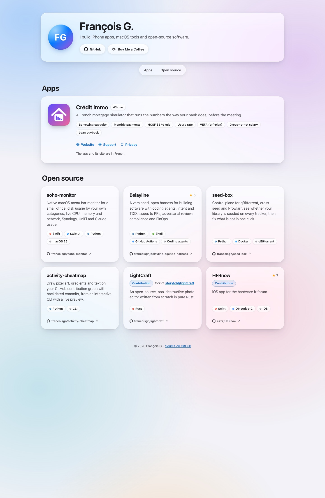

# francois-g.com


[](https://github.com/francoisgn/francois-g.com/actions/workflows/ci.yml)


[](LICENSE)
[](https://buymeacoffee.com/francoisgn)

> The personal showcase site of François G.: profile (LinkedIn, GitHub), App Store apps and open-source projects,
> as cards with technology chips, descriptions and links. Static, fast, served by GitHub Pages on
> [francois-g.com](https://francois-g.com).

**TL;DR**: an Astro static site, designed in the Liquid Glass spirit (Apple system fonts, glass cards, subtle
gradients), built and deployed by CI from `main`. Nothing runs on a home server. Status: **v1** (one page: profile,
apps, open source); see the [issues](https://github.com/francoisgn/francois-g.com/issues).



## Architecture

```text
 src/ (Astro pages, components, project data)
   │  npm run build (CI, every push and PR)
   ▼
 dist/ ── main only ──▶ GitHub Pages ──▶ https://francois-g.com  (DNS at Gandi: apex + www → Pages)

 nas.francois-g.com / ui.francois-g.com: local names on the home network (UniFi local DNS, VPN),
 and HTTPS redirects from the Internet (QuickConnect, unifi.ui.com). No port is opened at home.
```

| Path | Role |
|---|---|
| `src/pages/index.astro` | The one page: header, apps, open source, footer |
| `src/layouts/Layout.astro` | Page shell: meta (Open Graph, Twitter), favicon, skip link |
| `src/components/` | `GlassCard`, `Chip`, `Header`, `AppCard`, `ProjectCard`, `Footer`, `Icon` (inline SVG) |
| `src/styles/global.css` | Liquid Glass tokens (colours, glass, shadows), light and dark |
| `src/data/` | Typed content: `profile.ts`, `apps.ts`, `projects.ts` (placeholders marked `TODO(operator)`) |
| `src/lib/stars.ts` | GitHub stars fetched at build time; any API error keeps the static fallback |
| `public/` | Static files: `CNAME` (custom domain), favicon, touch icon, `og.png`, app icons |
| `docs/screenshots/` | Desktop and mobile, light and dark |
| `Dockerfile`, `compose.yaml` | Dev and test container (`docker compose up dev`) |
| `.github/workflows/ci.yml` | pre-commit, `astro check`, build, gitleaks; deploy to Pages from `main` |

## Quick start

With Node 24+ (`.nvmrc`):

```sh
npm ci
npm run dev        # http://localhost:4321
npm run check && npm run build && npm run preview
```

Or in a container (OrbStack or Docker Desktop):

```sh
docker compose up dev              # hot reload on http://localhost:4321
docker compose run --rm check      # astro check + build, as CI
```

## Editing the content

Everything shown comes from `src/data/`. Search for `TODO(operator)` for what is still to fill in (bio, photo,
LinkedIn URL, App Store URL); an unset link is not rendered. Star counts are fetched from the GitHub REST API at build
time, without a token; when the API fails or is rate-limited, the `stars` value of `projects.ts` is used and the
build goes on. Set `GITHUB_API_URL` to an unreachable URL to try that path.

## Development

```sh
pre-commit install            # once per clone (hooks pinned)
scripts/local-check.sh        # pre-commit + astro check + build, as CI
```

Coding agents follow [`CLAUDE.md`](CLAUDE.md) / [`AGENTS.md`](AGENTS.md) and the
[Belayline](https://github.com/francoisgn/belayline-agentic-harness) harness; see also
[CONTRIBUTING.md](CONTRIBUTING.md), [SECURITY.md](SECURITY.md) and [CHANGELOG.md](CHANGELOG.md).

## License

Code: [MIT](LICENSE). Personal content (texts, photo, logos of the projects) is not covered by the licence. The vendored
harness files in `.harness/` carry Belayline's own MIT licence.

## Support

[](https://buymeacoffee.com/francoisgn)
